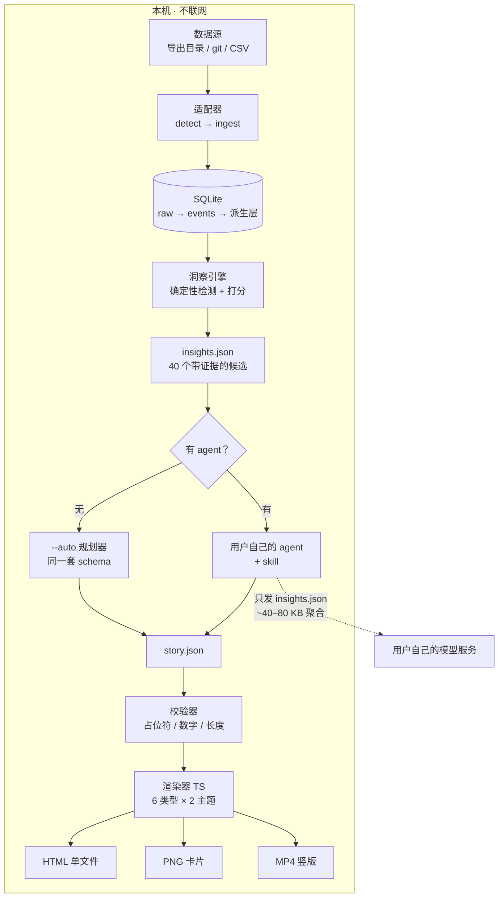

# recapkits 开发文档

**一个本地优先、插件化的「任意数据的年度回顾」引擎。**
把任意数据导出丢进来，在本机生成一份可分享的竖向故事卡片（HTML / PNG / MP4）。不上传、不遥测、不需要账号。

| | |
|---|---|
| **文档版本** | v2.2（合并初稿 + 定名 `recapkits` + 定许可证 MIT + 排期改为工期估算） |
| **日期** | 2026 年 11 月 11 日 |
| **包名** | `recapkits`（PyPI / npm / GitHub 三处均已核实可用） |
| **命令行** | `recap`（短、好打，与包名解耦） |
| **许可证** | MIT（已定） |
| **工作量** | **T3 = 310 h**（v0.1.0）；T4 完整 MVP = 424 h。明细见 §6 |
| **发布方式** | 按完成度发布，不以营销日历倒推（D12） |
| **硬约束** | 无作者侧服务、无遥测、无上传。核心不发起任何网络请求 |

---

## 0. 一页速览

### 0.1 一句话

> 丢进任意数据导出，得到一份属于你自己的年度回顾，全程在本机完成，做完就能发。

### 0.2 十二个已定决策

评审时只需要挑战这张表。每条都标了"改错的代价"，代价高的地方才值得争论。

| # | 决策 | 理由 | 改错代价 |
|---|---|---|---|
| D1 | **Python 做数据引擎，TypeScript 做渲染器**，二者只通过三个 JSON 文件通信 | Python 标准库处理 GB 级流式解析最省事；TS 负责排版与视频 | 高（中途合并语言 ≈ 1 周） |
| D2 | **主入口是 `uvx recapkits`**，渲染器构建产物打进 wheel，终端用户不需要 Node | 一次解决"运行时从哪来"的问题；`npx` 只作后续薄包装（§3.3） | 高（分发形态决定首日成功率） |
| D3 | 引擎**零 C 扩展依赖**（仅标准库） | 安装秒级、无编译、CI 三平台一致 | 中 |
| D4 | 工具内**不调用任何 LLM**；用户自己的 agent 写 `story.json`；`--auto` 必须能出好结果 | 这是隐私承诺，也是成本结构 | 高（反过来就毁掉定位） |
| D5 | 文案中的数字**只能来自占位符**，校验器硬拦截 | 让"模型写文案"这件事的幻觉面积归零 | 高 |
| D6 | 一等适配器 **3 个**（spotify / netflix / git），`csv_generic` 作兜底，2 个 beta | 8 个适配器不是 MVP，是 v0.3（§4.1 有工时账） | 高（工作量的根因） |
| D7 | **6 个卡片类型 × 2 个主题**，两个概念不混用 | 类型是版式，主题是皮肤；混用会让"再加一个模板"变成两件事 | 低 |
| D8 | **MP4 是一等输出**，但相关依赖装在 `recapkits[render]` 里按需安装 | 竖向视频就是分发渠道；但默认安装不能因此变重 | 高（砍掉 MP4 等于砍掉传播） |
| D9 | 名字不含 "Wrapped"；定名 **`recapkits`**，PyPI / npm / GitHub 三处今日均已核实未占用 | 商标与可用性都要在写第一行 README 之前定 | 中（发布后改名 = 白丢一次发布） |
| D10 | 聊天类导出**默认只聚合**，正文需显式开关 | 最高伤害、最低必要性的类别 | 低（但泄漏不可逆） |
| D11 | 许可证 **MIT** | 采用门槛最低；后改需全体贡献者同意 | 中 |
| D12 | **按完成度发布**：不以营销日历倒推排期，日期是结果不是输入 | 倒推式排期会挤出质量项（MP4、校验器、测试），而这些恰好是产品本身 | 中（错过窗口是机会成本，不是错误） |

### 0.3 前置状态

| 事项 | 状态 |
|---|---|
| 包名 `recapkits` | ✅ 已定，三处未占用（§10.2） |
| 许可证 | ✅ **MIT**（§10.4） |
| 发布节奏 | ✅ 按完成度发布，不做潮汐营销（D12） |
| `Bionic` 代码复核（决定是否做它的下游） | ⏳ 建议 11/17 前，半天时间可能省两周（§2.2） |
| 域名 `recapkits.dev` / `.com` | ⏳ 建议 11/20 前，先查可注册性 |
| 默认语调 `deadpan` / `playful` | ⏳ W2 前 |

---

## 1. 产品定义

### 1.1 命令体验

```bash
# 主路径：一条命令，自动完成导入 → 洞察 → 故事 → 渲染
$ uvx recapkits ~/Downloads/my-exports

  ◐ 扫描 ~/Downloads/my-exports
    ✓ spotify      扩展流媒体历史 · 41,208 次播放 · 2015-03 → 2026-11
    ✓ netflix      观看记录 · 3,914 行 · 2 个档案 · 2019-01 → 2026-11
    ✓ git          ~/code · 1,102 次提交 · 34 个仓库

  ◑ 导入 → .recapkits/recap.db (61 MB)   用时 18s
  ◒ 计算洞察 → 214 个候选，选出 40 个
  ◓ 生成故事（--auto 模式）
  ◔ 渲染 9 张卡片 · 9:16 / 4:5
  ✓ .recapkits/out/recap-2026.mp4      38.4s · 24.1 MB
  ✓ .recapkits/out/recap-2026.html     单文件，1.3 MB

  想让它写得更好？在你的 agent 里说：
      "读 .recapkits/insights.json，按 skill 写 story.json"
  本机数据未离开这台机器。查看会外发的内容：
      uvx recapkits insights --payload-preview
```

分步命令保留给 agent 驱动，每一步都可检查、可回滚：

```bash
uvx recapkits init                       # 建工作区，设时区与年份
uvx recapkits import <path>              # 检测适配器 → 入库 → 导入报告
uvx recapkits insights --json --top 40   # 输出候选洞察
uvx recapkits story --check story.json   # 校验 agent 写的故事
uvx recapkits render --format mp4        # 渲染
uvx recapkits redact story.json          # 生成可分享版本
uvx recapkits doctor                     # 诊断
```

### 1.2 三类用户

| 用户 | 他们要什么 | 他们怎么进来 |
|---|---|---|
| **普通用户** | 一个能发的、关于自己这一年的视频，而且不想上传数据 | 看到一个视频 → 搜到 README → 跑一条命令 |
| **开发者**（首发种子人群） | 对本地数据做回顾，最好连导出都不用等 | "你的 git 和终端里的一年"——零导出、零等待 |
| **贡献者** | 一个边界清晰、能在一个下午做完的扩展点 | "30 分钟写一个适配器"指南 + 10 个 good first issue |

开发者这条线不是次要人群，它是**首日成功率最高的路径**：`git` 适配器不需要等导出邮件，是发布当天最多人能立刻跑通的那条命令。

### 1.3 六条原则

1. **本地只有本地。** 不上传、不遥测、不登录、不校验授权。
2. **数字来自 SQL，文字来自 agent。** 模型可以选、可以写，永远不能自己敲一个数字。
3. **没有 LLM 也能用。** `--auto` 的确定性故事必须是"能发"的水平，agent 只是把它变得更好。
4. **好看是功能，不是装饰。** 这个产品被评判的方式就是输出好不好看，设计时间要写进排期。
5. **默认保守。** 涉及他人（聊天）与敏感类别（健康、财务）的，默认聚合或屏蔽，需用户显式开启。
6. **插件优先，但插件不碰统计。** 适配器只负责解析成事件，主题只负责摆放文字，统计只有一份实现。

### 1.4 非目标（v1）

- 不做托管服务，不做接收用户数据的网页。
- 不做账号登录与抓取，只用官方导出与本地文件。
- 不做移动端 App。手机是**分发场景**，不是平台。
- 不做精神状态、亲密关系、健康状况的推断。数据只描述行为，不解释人。
- 不做 dashboard。这是故事，不是分析工具。（想要 dashboard 的话，`datasette .recapkits/recap.db` 已经能用了。）

---

## 2. 定位

### 2.1 四象限与空位

按两个轴拆：**覆盖范围**（单源 / 多源）与**运行位置**（他们服务器 / 你的机器）。现有工具全部落在角上。

| 类别 | 代表 | 做得好的地方 | 停在哪 |
|---|---|---|---|
| **官方单源回顾** | Spotify Wrapped、Apple Music Replay、Steam Year in Review、Strava Year in Sport、Duolingo Recap | 制作水准无法比肩；免费的心智预训练 | 只有自家服务、不能导出、不能定制、不能跨源；平台不想做就不存在 |
| **托管式单源生成器** | stats.fm、各类"wrapped for X"网站、`cursorwrapped.com` | 零摩擦：授权或上传，立刻出结果 | 数据在别人服务器上；单源；只出图片；链接会烂；通常是二月就停更的业余项目 |
| **本地优先单源** | `cursor-wrapped`（读 Cursor 本地 SQLite）、`rewind-for-ai-chats`（本地归档 + 年度回顾 + SQLite） | 真的本地、真的有人用，且证明需求存在 | 单一数据类别；浏览器应用；无视频；无插件模型 |
| **agent 辅助报告工具** | `self-review`（Python + SQLite 缓存，用 `claude -p` 写 git 总结） | 验证了"用用户自己的 agent 写文案"这条路可行 | 范围窄（提交），纯文本，无设计，无适配器 |
| **个人数据仓库** | Dogsheep / Datasette（`twitter-to-sqlite`、`healthkit-to-sqlite`、`github-to-sqlite`）、Observable、Grafana | 严谨、可扩展、受尊重 | 出 dashboard，不出叙事；没有任何可分享的成品 |
| **手工** | CapCut / Canva 的"年度回顾"模板 | 完全可控 | 每条视频两小时，而且一眼就是模板 |

**空位是：本地优先 × 多源 × 可直接发布的竖向视频。** 四个象限里没有人占。

### 2.2 Stage 0 需要复核的两个邻居

初稿提到的 `YearReview`、`Bionic`、`get-wrapped`、`year-in-code` 我**没能核实其范围、许可证与活跃度**，因此不写进上表。它们仍然是值得花半天读代码的对象：

| 项目 | 初稿的描述 | Stage 0 要回答的问题 |
|---|---|---|
| `YearReview` | 从 Strava/Spotify 等服务的数据生成年度回顾 | 是否已覆盖多源？许可证？是否值得直接复用其适配器？ |
| `Bionic` | 把多服务导出转成 SQLite，文档里自己提到"年度回顾生成器"是个生态位 | 能否互操作（读它的库）？这是最强邻居，最该先读 |

**判断规则：** 如果 `Bionic` 已经把多源导入做扎实了，就把 `recapkits` 定位成它的**下游**——"读你的库，出视频"，而不是重写导入层。这会省掉两周，代价是多一个依赖。这个判断必须在 W1 结束前做完，因为它决定 D6 的适配器工作量。

### 2.3 诚实的反面论证

"Wrapped"是一个商品化的格式。做一个商品化格式的通用引擎，本质是**功能生意**，不是护城河生意。真正能沉淀的只有三样：

1. **适配器生态**——每一个都是迁移成本；
2. **洞察库里"什么才算意外"的判断力**——比解析器难抄；
3. **主题系统的设计水准**——抄袭会很明显。

护城河在第 2–6 个月长出来，不在发布当天。排期和期望值都要按这个前提设。

---

## 3. 架构

### 3.1 数据流



唯一离开本机的箭头指向**用户自己的模型服务**，携带的是 `insights.json`——聚合值、40–80 KB、没有原始行、时间精度不超过"天"。`--local-only` 会把这条箭头也去掉。

### 3.2 三个文件契约

Python 与 TypeScript 之间只有文件，没有 RPC、没有端口、没有共享内存。

| 文件 | 方向 | 内容 | 体量 |
|---|---|---|---|
| `insights.json` | 引擎 → 所有人 | 事实：候选洞察、证据 SQL、打分拆解、敏感级 | 40–80 KB |
| `story.json` | agent/auto → 渲染器 | 决策：选哪些、什么顺序、什么措辞、用哪个主题 | ~3 KB |
| `render-report.json` | 渲染器 → 用户 | 度量：溢出、对比度、安全区、耗时 | ~2 KB |

**契约是文件，所以用户的 agent 可以直接产出 `story.json`，不需要 API key，也不需要我们付 token。** 这是整个产品最重要的一条结构性选择：它同时解决了隐私、成本和可复现性。

### 3.3 分发形态（决策 D2）

初稿选择了 `uvx`，我认为这是对的，而且是这份初稿里最有价值的一个判断。理由：

`npx` 作为入口会制造一个自己给自己挖的坑——Node 进程要拉起 Python 引擎，就得解决"用户的 Python 在哪、版本够不够、能不能装依赖"。这条链有五种失败方式，每一种都对应一批"装不上，一星"。

`uvx` 把这整条链消掉了：一个二进制、自带解释器管理、安装即缓存、跨平台。代价是用户得先有 `uv`（一行 curl）。对开发者受众，这个代价远小于 npx 方案的失败率。

| 方案 | 命令 | 首次成功率 | 代价 |
|---|---|---|---|
| **A. `uvx` 为主**（选定） | `uvx recapkits ./exports` | 高（uv 自带 Python） | 用户需装 uv；渲染器产物须打进 wheel |
| B. `npx` 为主 | `npx recapkits ./exports` | 低（需自建 Python 引导链） | 双运行时；引导链要维护 |
| **C. `npx` 薄包装**（发布后加） | `npx recapkits` → 内部调 `uvx` | 高 | 一个 30 行的包装包，成本极低 |

**落地方式：** A 在 v0.1.0 上线；C 在 v0.2 补上，满足"开发者习惯 npx"的场景。C 不重写任何逻辑，只做检测与转发，所以不会分裂代码路径。

**渲染器怎么进 wheel：** `renderer/` 用 Vite 构建成静态资源（约 1.2 MB），在 `uv build` 时拷进 `src/recapkits/render/assets/`。CI 里加一条一致性检查：wheel 内资源的哈希必须等于前端构建产物的哈希，防止"改了前端忘了重建"。

**渲染依赖的处理（D8）：**

```bash
uvx recapkits ./exports                    # 出 HTML，零额外依赖
uvx --with "recapkits[render]" recapkits ./exports   # 出 PNG / MP4
```

`[render]` 只包含 Playwright 与 ffmpeg 的获取逻辑。原则：**先借用本机已装的 Chrome / Edge**（覆盖绝大多数桌面机），都找不到才提示下载，且明确告知体积。HTML 输出在任何情况下都可用——这是整个产品的降级底线。

### 3.4 数据模型

```sql
PRAGMA journal_mode = WAL;

-- 第一层：原始行，只追加，形状随适配器
CREATE TABLE raw_row (
  adapter   TEXT NOT NULL,
  src_file  TEXT NOT NULL,
  src_line  INTEGER NOT NULL,
  payload   TEXT NOT NULL,          -- 原始 JSON / CSV 记录
  PRIMARY KEY (adapter, src_file, src_line)
);

-- 第二层：规范化事件（全产品只有这一张主表）
CREATE TABLE events (
  id            INTEGER PRIMARY KEY,
  source        TEXT NOT NULL,       -- 'spotify' | 'netflix' | 'git' | ...
  kind          TEXT NOT NULL,       -- 'play' | 'watch' | 'commit' | 'workout' | ...
  ts_utc        TEXT NOT NULL,       -- ISO 8601，UTC
  tz_offset_min INTEGER,             -- 仅当源本身带偏移时写入（git / Apple Health）
  title         TEXT,                -- 曲名 / 剧集 / 提交摘要
  subtitle      TEXT,                -- 艺人 / 剧名 / 仓库
  category      TEXT,                -- 流派 / 语言 / 标签
  duration_s    REAL,
  value         REAL,                -- 金额、距离、卡路里
  sensitivity   TEXT NOT NULL DEFAULT 'low',   -- low | medium | high
  flags         TEXT,                -- {"skipped":1,"trailer":1,"incognito":1}
  meta_json     TEXT,
  row_hash      TEXT NOT NULL       -- 幂等键：source+ts+title+duration
);
CREATE INDEX idx_ev_src_ts   ON events(source, ts_utc);
CREATE INDEX idx_ev_rowhash  ON events(row_hash);

-- 第三层：派生（可随配置变更整层重建）
CREATE TABLE event_local (
  event_id   INTEGER NOT NULL,
  tz         TEXT NOT NULL,          -- IANA 时区名
  local_date TEXT NOT NULL,          -- YYYY-MM-DD
  local_hour INTEGER NOT NULL,
  PRIMARY KEY (event_id, tz)
);

CREATE TABLE import_reports (
  source TEXT, src_hash TEXT, rows INTEGER, skipped INTEGER,
  warnings TEXT, coverage REAL, created_at TEXT
);

CREATE TABLE build (
  build_id TEXT PRIMARY KEY,         -- 哈希(引擎版本+适配器版本+输入指纹+选项)
  options  TEXT NOT NULL,
  manifest TEXT NOT NULL             -- 只存哈希，不存路径
);
```

**两个关键取舍：**

1. **时间处理。** Spotify 与 Netflix 的导出**只给 UTC、不带偏移**，所以"按事件当时的本地时间"在原理上做不到。正确做法是：存 UTC，用 `recap init` 时设定的 IANA 时区在查询期换算；当源本身带偏移（git 提交、Apple Health）时，优先用源里的偏移。所有本地时间逻辑只写在 `tz.py` 一个文件里，禁止在查询里内联 `strftime('%H')`。
2. **`manifest` 只存哈希不存路径。** `/Users/jane.doe/…` 出现在一张会被截图发出去的数据库里就是一次泄漏。

### 3.5 适配器接口

```python
class Adapter(Protocol):
    id: str                       # "spotify"
    description: str
    def detect(self, path: Path) -> float: ...            # 0..1 置信度
    def ingest(self, path: Path, db: sqlite3.Connection) -> IngestReport: ...
    def detectors(self) -> list[Detector]: ...            # 该源特有的洞察
    def min_engine(self) -> str: ...                      # 版本约束
```

通过 Python entry point 注册（`recapkits.adapters`），第三方可以独立发包。同时支持 `./recap.toml` 指向本地目录，方便贡献者不必先发布。

**信任模型要说得直白：** 适配器在进程内运行、拥有用户权限，和 `pip install` 是同一个信任级别。manifest 里的 `capabilities` 是**声明并打印，不做强制**——我们造不出能扛住恶意插件的沙箱，而虚假的安全承诺比没有承诺更糟。所以 `recap plugin add` 会打印路径、权限、sha256，文档里"读代码"那句话不是客套。

### 3.6 洞察引擎

**洞察不是统计量。** 统计量是"你听得最多的是 X"；洞察是"X 占了你全部收听的 31%，比你自己的三年中位数高 4.2σ"。

```python
@dataclass(frozen=True)
class Fact:
    key: str            # "share"
    label: str          # "占全部收听的比重"
    value: float | str
    unit: str | None    # count | pct | duration | rank | date
    display: str        # 唯一允许被文案引用的形态

@dataclass(frozen=True)
class Insight:
    id: str
    kind: str
    period: Period                 # start, end, tz, coverage(0..1)
    headline: Fact
    facts: list[Fact]
    evidence_sql: str              # 可复跑
    score: float
    score_parts: dict[str, float]  # 可解释
    novelty: str                   # record | rare | shift | constant | absence
    sensitivity: str               # low | medium | high
    caveats: list[str]
    min_days_met: bool
```

**洞察库**（v1 上线 14 个，其余列为后续）：

| 族 | 成员 | 来源 |
|---|---|---|
| 体量 | `total_volume`、`median_day`、`record_day`、`yoy_delta` | 全部 |
| 集中度 | `one_obsession`、`top1_share`、`gini`、`taste_entropy` | spotify / netflix / git |
| 时间 | `hour_centroid`、`late_night_share`、`weekday_rhythm`、`busiest_month` | 全部 |
| 行为 | `skip_rate`、`completion_rate`、`binge_run` | spotify / netflix |
| 断裂 | `longest_streak`、`longest_gap`、`first_last`、`milestone` | 全部 |
| 身份 | `archetype`（显式规则，非模型）、`era_chapter`（月度向量变点） | 全部 |
| **跨源 ★** | `correlated_rhythm`、`attention_budget`、`screen_vs_body`、`taste_vs_code` | ≥2 源 |

★ 跨源四类是插件架构存在的唯一理由。单源工具在任何价位都做不出来，这是"通用引擎"这个说法唯一站得住的证据。

**惊喜度打分**（完全确定，无学习权重）：

```
score = 1.00 × 自身基线偏离      # 与本人历史期的稳健 z（中位数/MAD）
      + 0.60 × 稀有度            # 对照随包发布的静态先验表，永不采集
      + 0.50 × 不连续性          # 首次出现、历史最高、连续中断、归零月
      + 0.40 × 集中度变化        # top1 占比 / Gini 相对同窗口变化
      − 0.45 × 老套惩罚          # 每个用户前五都会出现的类型，降权
      − 1.00 × 敏感惩罚          # 未显式开启时
```

**序列级多样性。** 单个分数高不等于整份回顾好看：十个"你的第一"是最常见的失败。所以选卡用贪心 MMR：

```
选 i 时： argmax [ score(i) − λ · max_{j∈已选} sim(i, j) ]
sim(i,j) = 1.0（同源同 kind）｜0.7（同实体）｜0.3（同族）｜0
```

**四条防止"错的洞察"的硬规则：**

1. **同比必须同窗口截断。** 11 月跑当年数据只有 315 天，直接对比上一整年会为每个用户伪造一条"你听得少了 14%"。所有跨期比较截到相同"年内第 N 天"，并把 `coverage: 0.86` 作为 caveat 带进卡片。
2. **样本门槛，宁缺不凑。** 少于 50 条事件不出 Top-N；少于 30 个活跃日不出节律/连续类；不足两年不出同比。数据不够就跳过这个源，不要用噪声垫卡片。
3. **计数口径要跟源一致。** Spotify 官方 Wrapped 只算播放超 30 秒、且排除隐私会话；原始导出全都有。默认镜像 30 秒口径（`--min-play 30s`），并把差异写进 caveat——否则用户对照官方数字时会认为我们算错了。
4. **"没有发生"是一等公民。** `longest_gap`（三月起不再听播客）、"全年周日零播放"、`streak` 中断——实测这些往往是最意外的卡，因为用户自己不知道。

### 3.7 story 契约与校验器

初稿提出"文案里的数字只能来自占位符"，这比我原来的"写完再校验数字"更强：把约束前移到结构里，模型**没有地方**写一个自由数字。这是全文档最值得保留的一个设计。

```json
{
  "version": 1,
  "meta": { "year": 2026, "locale": "zh-CN", "theme": "neon", "tone": "deadpan",
            "tz": "Asia/Shanghai", "build_id": "b3:9f2c…" },
  "cards": [
    { "id": "c1", "type": "cover",
      "copy": { "headline": "你的 2026", "kicker": "本地生成 · 未上传" } },

    { "id": "c2", "type": "big-number",
      "insight": "vol.total_hours",
      "copy": { "headline": "{{vol.total_hours.hours}} 小时",
                "sub": "相当于 {{vol.total_hours.days}} 天，一天不落地听了十一个月。" } },

    { "id": "c3", "type": "ranking",
      "insight": "conc.one_obsession",
      "copy": { "headline": "你的年度执念" } }
  ]
}
```

**校验器规则（`recap story --check` 与渲染前各跑一次）：**

| # | 规则 | 失败处理 |
|---|---|---|
| V1 | 每个 `{{...}}` 必须解析到**被该卡引用洞察**的某个 fact | 硬失败，返回可定位错误 |
| V2 | 文案中不得出现未经占位符引入的数字：阿拉伯数字、全角数字、Unicode 数字、**中文数词（三/千/两）**、英文数词（three） | 硬失败；白名单仅限年份与显式标注的例外 |
| V3 | 卡片必须引用存在的 insight，且 `type` 与 `insight.kind` 兼容 | 硬失败 |
| V4 | 槽位长度上限由**真实字体度量**决定（渲染时测量），不是字符数 | 硬失败 |
| V5 | `sensitivity: high` 的洞察需 `allow_sensitive`，且**该值只能来自命令行参数，写在 story.json 里一律忽略** | 该卡被丢弃，自动补位下一候选 |
| V6 | 专有名词必须来自实体表 | 硬失败（防"你今年最爱大概是 Radiohead 吧"） |
| V7 | 禁止因果与诊断表述（健康、金钱、关系），禁止以用户为笑点的嘲讽 | 硬失败 |

V5 是初稿里一个容易被忽略但很关键的细节：**授权不能由 agent 自己写**。agent 有能力在 JSON 里写 `"allow_sensitive": true`，所以校验器必须在结构上无视它。

V2 里的中文数词是这份文档相对英文版新增的——中文回顾里"三"和"3"一样是数字，只拦阿拉伯数字等于没拦。

失败时返回结构化错误，供 agent 一次修复：

```json
{
  "ok": false,
  "errors": [
    { "code": "NUMBER_NOT_IN_PLACEHOLDER", "card_index": 1, "slot": "sub",
      "got": "四", "expected": "使用 {{vol.total_hours.days}}",
      "hint": "引用被引洞察里的 fact，或删掉这个数字" }
  ]
}
```

`hint` 字段存在的理由：agent 只有一次修复机会，好的错误信息是"自愈"与"降级到模板文案"之间的差别。

### 3.8 渲染层

**两个概念必须分开**（初稿混用了，这是它最容易在实施时失控的地方）：

- **卡片类型（type）**＝版式原语。v1 六个：`cover`、`big-number`、`ranking`、`heatmap`、`clock`、`summary-grid`。
- **主题（theme）**＝视觉皮肤。v1 两个：`neon`（暗底、饱和渐变、巨大数字）、`editorial`（米色、衬线、细分隔线）。

6 × 2 = 12 种呈现，但只有 8 份需要设计的工作量（类型共用栅格，主题只换 token）。这就是为什么两个主题要选**相反的调性**——它一次证明"这是系统，不是 Spotify 仿品"。

| 输出 | 依赖 | 说明 |
|---|---|---|
| **HTML** | 无 | 单文件、内联资源、无 JS、手机可开。永远可用，是降级底线 |
| **PNG** | Chromium | 9 张 × 三种比例；重编码以清除 `tEXt` 块 |
| **MP4** | Chromium + ffmpeg | 竖版 1080×1920，H.264 / yuv420p / CRF 18 / `+faststart` |

**排版规格**：1080×1920 基准；12 栏；外边距 72；栏间距 24；栏宽 56。上下各留 240 px 给平台 UI；内容限制在 88% 标题安全区内。字号序列 320/220/140/88/56/40/28。数字用等宽数位（tabular），字距 −2.5%。

**确定性**：固定视口与 `deviceScaleFactor: 1`；字体为随包 WOFF2 子集；渲染时拦截所有网络请求；动画由 `data-frame` 驱动而非墙钟时间，所以"第 N 帧"是纯函数；装饰性随机来自以 `build_id` 为种子的 PRNG。

**MP4 采集策略**（混合式，兼顾质量与耗时）：静止段用单张截图，入场/数字滚动段用 CDP 逐帧采 8–12 帧，最后 `ffmpeg -f concat` 组帧。目标：9 卡故事 ≤ 90 秒出片，`--fast` 模式 ≤ 20 秒。38 秒竖版视频控制在 25 MB 内，发出去不用二次转码。

### 3.9 插件与生态

```json
{
  "id": "recapkits-adapter-netflix",
  "type": "adapter",
  "version": "0.4.2",
  "engine": ">=0.4 <1",
  "entry": { "python": "recapkits_netflix.adapter:Adapter" },
  "detect": ["**/CONTENT_INTERACTION/ViewingActivity.csv"],
  "capabilities": ["read:files", "emit:event:watch"],
  "fixtures": ["fixtures/netflix-2024.csv"],
  "license": "Apache-2.0"
}
```

解析顺序：内置 → `./recap.toml` → 已安装包。冲突报错，不做"后者覆盖"。

**生态启动的三个动作**（比写文档更管用）：

1. `uvx recapkits new-adapter` / `new-theme` 脚手架：带 fixture、带一个失败的测试、带 doctor 契约。
2. **"30 分钟写一个适配器"**指南：目标是一个下午能发出 PR。
3. **10 个以上 `good first issue`**：新适配器（letterboxd / goodreads / strava / telegram / kindle）、新洞察、新主题、新语言。

主题画廊用 CI 自动生成：每次 push 都用固定 fixture 渲染仓库里每个主题，输出缩略图。这样画廊**不可能过期**——而画廊过期是所有插件生态的死因。

### 3.10 确定性与测试

| 层 | 检查 | 门槛 |
|---|---|---|
| 导入 | 行账：`已解析 + 已跳过(有原因) == 源行数` | 100%，逐文件 |
| 导入 | 编码/分隔符矩阵：utf-8-sig、cp1252、CRLF、引号内逗号 | 全过 |
| 导入 | 幂等：同一文件导入两次，计数不变 | 相等 |
| 时间 | 夏令时属性测试（`hypothesis`）：春进、秋退、闰年、午夜 | 全过 |
| 洞察 | `insights.json` 快照 | 逐字节一致 |
| 洞察 | `--explain` 能从原始表重算出 `score_parts` | 精确 |
| 文案 | 12 个对抗性 `story.json`（编造数字、中文数词、越界长度、越权敏感） | 全部拒绝 |
| 渲染 | PNG 感知差异 | ≤ 0.3% |
| 渲染 | MP4 帧数、时长、3 个抽样帧哈希 | 精确 |
| 隐私 | 构建产物中的外联域名白名单 | 只允许空集 |
| 隐私 | 输出中不含绝对路径、用户名、主机名 | 零命中 |

**最后两条要最先写。** 没有测试的隐私承诺只是文案。

### 3.11 诊断：`recap doctor`

单人维护五个适配器，诊断就是支持策略本身。

```
$ uvx recapkits doctor
  spotify      ✓ 41,208 次播放 · 2015-03-02 → 2026-11-08 · 2 文件 · schema v3（已知）
  netflix      ⚠ 3,914 行 · 2 档案 · 未知列 "Latest Offline Save"
                 → 仍然解析；跳过 412 行（TRAILER/HOOK）
  git          ✓ 1,102 次提交 · 34 仓库
  时区          ✓ Asia/Shanghai（DST：无）
  渲染依赖      ⚠ 找到 Chrome 131，可出 PNG/MP4；未找到 ffmpeg → 仅 PNG

  可粘贴的诊断（只含计数与列名，绝不含你的数据）：
    uvx recapkits doctor --report > recap-report.txt
```

列名**指纹**（表头集合的哈希）让我们能在不接收任何一行的前提下远程判断格式漂移。

### 3.12 与 AI 助手协作的硬规则

项目本身用 agent 来建，所以 `CLAUDE.md` / `AGENTS.md` 要写死几条不可协商的规则（初稿这一节很实用，保留）：

```markdown
# 硬规则
- 核心绝不发起网络请求。禁止遥测。
- 故事里的数字只能经占位符从 insights 取。不许弱化校验器。
- 所有本地时间逻辑走 src/recapkits/tz.py，禁止内联。
- 适配器必须容忍未知字段（警告而非崩溃），必须幂等。
- 公开测试与演示只用合成数据。
- 不许凭记忆猜导出格式：先要样本，或对着 fixture 写。

# 流程
- 先说方案与要改的文件，再动手。
- 适配器、检测器、校验器一律测试先行。
```

---

## 4. MVP 范围

### 4.1 先把账算清：为什么不是 8 个适配器

初稿列了 8 个适配器（spotify、netflix、takeout、apple_health、git_local、shell_history、vault、csv_generic）。这是一个好的**路线图**，但不是 5 周能做完的 **MVP**。

真实成本（单人、有真实样本、要过测试）：

| 阶段 | 工时 |
|---|---|
| 脚手架 + detect | 0.5 天 |
| 顺利路径解析 | 1 天 |
| 真实导出边界情况（编码、重复、缺字段、口径） | 2 天 |
| 测试 + fixture + doctor 契约 | 0.5 天 |
| **单个适配器** | **≈ 4 天** |

8 × 4 = 32 天 ≈ 6.4 周，而且这还没算渲染器、校验器和 skill。**8 个适配器不是 MVP，是 v0.3。** 这就是初稿排期过载的根因——不是因为不努力，是因为把路线图当成了本期范围。

### 4.2 适配器矩阵

| 适配器 | 状态 | 格式 | 为什么是这个状态 |
|---|---|---|---|
| **spotify** | 一等 | 扩展流媒体历史 JSON | 五个里最干净的 schema；认知度最高；情感回报最大 |
| **netflix** | 一等 | `ViewingActivity.csv` | "我已经有这个文件"的比例最高；CSV 最好验证 |
| **git** | 一等 | 本地 `git log`（可选 GitHub GraphQL 富化） | **零导出、零等待**；开发者受众的当天可跑通路径；同时服务 GitHub 演示 |
| **csv_generic** | 兜底 | 用户映射列（日期/标题/数值） | 它让"任意数据"这个承诺在 v1 就成立，成本只有 1.5 天 |
| **apple_health** | beta | `export.xml`，GB 级 | 最"哇"，但 4 GB XML + 最敏感数据 + 只有 iOS 能导出。标 beta 才诚实 |
| **google_takeout** | beta | JSON，格式在漂 | 覆盖面最广、格式最不稳（§11.5）。同样只能标 beta |

**被推迟的，以及理由（不是"没时间"，是"性价比不成立"）：**

| 项 | 推迟理由 |
|---|---|
| `shell_history` | 多数用户的 shell 历史**没有时间戳**（需预先设 `HISTTIMEFORMAT`），只能出"最常用命令"一张卡，撑不起一个适配器 |
| `vault`（Obsidian） | 有意思，但文件 mtime 在各种同步后被改写，时间分布不可信。留作 good first issue |
| `spotify` 播客/有声书细分 | 与音乐共用一张表即可，单独做不值 |

### 4.3 卡片类型 × 主题

| 类型 | 职责 | 数据需求 |
|---|---|---|
| `cover` | 冷开场：年份 + 一个数字，不问候、不自我介绍 | 总量 |
| `big-number` | 让数字有物理感（"2,431 小时 ≈ 101 天"） | 总量 |
| `ranking` | Top-N 榜单，按主题可显示 3–5 项 | 集中度 |
| `heatmap` | 一年 365 格，强度分布 | 日粒度 |
| `clock` | 24 小时表盘 / 星期节律 | 时/周分布 |
| `summary-grid` | 单张信息卡——**被转发最多的那一张**，值得单独打磨 | 6–9 个事实 |

| 主题 | 调性 | 搭配 |
|---|---|---|
| **neon** | 喧闹：暗底、饱和渐变、320 px 数字、颗粒 | spotify、netflix |
| **editorial** | 安静：米色、衬线、细线、宽松行距 | health、git、阅读 |

### 4.4 完成定义（DoD）

- 在只有 Node 20+ / Python 3.11+ / uv 的干净 macOS、Windows 11、Ubuntu 22 上，`uvx recapkits` 端到端成功，Spotify+Netflix+git 三源合计 5 分钟内出片。
- 五个演示全部用真实导出产出、脱敏、发布。
- 无适配器配置时 `doctor` 可用且有建议。
- 12 个对抗性 `story.json` 全部被拒。
- 除用户 agent 调用外零外联，由 CI 的出网抓包测试证明。
- README 首屏有一个可播放的 38 秒 MP4 + 三行 quickstart。
- 每个一等适配器经 ≥2 份独立真实导出验证（§11.7）。

### 4.5 砍单顺序

按顺序砍，不要跳着砍。

1. 1:1 比例（保留 9:16 + 4:5）
2. `--music` 与随包音频
3. `csv_generic`（先只留三个一等适配器）
4. `google_takeout` → 发布后
5. `apple_health` → 发布后
6. `editorial` 主题（只发 neon，把一个做到极好）
7. `archetype` 洞察（最容易尬，最先砍）
8. 视觉回归测试（保留洞察快照测试）

**永不砍**：校验器、`--payload-preview`、`--auto`、redact 模式、MP4 输出、三平台 CI。这六样就是产品本身。

---

## 5. 自产演示

五份演示是市场预算，也是验收测试：**做不出演示的适配器，就是没做完的适配器。**

| # | 源 | 主题 | 撑住它的洞察 | 脱敏口径 |
|---|---|---|---|---|
| 1 | **spotify** | neon | 某艺人占全部收听 31%，比自己三年中位数高 4.2σ | 艺人名公开无妨；无地点、无 IP、无账号名 |
| 2 | **netflix** | neon | 41 天连续追剧；以及账号安静了 4 个月的那段 | 片名可留；**档案名替换**；时间粗化到天 |
| 3 | **google_takeout** | neon | 凌晨 3 点的搜索习惯；以及档案里那次跨城搬迁 | 搜索词**永不露出**，只出计数与时段 |
| 4 | **apple_health** | editorial | 一致性：214 天 ≥8k 步，以及七月断掉的两周 | **完全不出现身体指标**。无体重、无心率、无睡眠分期 |
| 5 | **git / GitHub** | editorial | 2,847 次贡献的一年，其中 71% 来自一个仓库 | 仓库名替换为类别（"一个私有 monorepo"）；提交信息不出现 |

**制作规约：**

- **先做 #5。** git 适配器 W1 就能用，它能最早产出可看的素材，也最早暴露设计问题。
- 每条出三种裁切：9:16（TikTok/Reels/Shorts）、4:5（Instagram 信息流）、1:1（X）。15 个素材，一条流水线，零额外设计。
- 另出 1 张 12 秒 GIF（<2 MB）作 README 首图。
- 每条配一段"这条是怎么做的、抹掉了什么"。**隐私工具如果自己的演示不透明，就不可信。**
- **#4 是这套素材里最重要的一个。** 它证明这不是音乐玩具；而它刻意不展示任何身体指标，证明我们懂这个类别的边界。

---

## 6. 工期估算

### 6.1 先纠正一个数字

上一版的"175 小时 / 5 周"是按发布日期倒推出来的，不是自下而上算的。倒推式估算有个通病：它永远恰好等于剩余时间，所以看起来永远可行。

下面这份是逐工作包加总的，**每个包都含自己的测试**（测试不单列，否则重复计算），也不含发布后的运营与社区维护。

| 口径 | 工时 | 含什么 |
|---|---|---|
| **T1 技术预览** | ≈160 h | 2 个适配器（git + spotify）、6 个检测器、3 个卡片类型、1 主题、HTML + PNG。能给人看，不能发 |
| **T2 可发布最小集** | ≈220 h | + netflix、MP4、5 个卡片类型、redact。**这是"能发"的下限** |
| **T3 v0.1.0** | ≈310 h | + 6 类型、agent skill、doctor、`--auto`、完整测试与文档 |
| **T4 完整 MVP** | ≈424 h | + editorial 主题、csv_generic、2 个 beta 适配器、画廊与 SEO 页、5 份演示 |

### 6.2 工作包明细（T3 = 310 h）

| 编号 | 工作包 | 工时 | 前置 | 可裁 |
|---|---|---|---|---|
| A | 地基与契约：仓库、三平台 CI、`events` 表、`tz.py` + DST 测试、适配器基类与 entry point、fixture 生成器 | 24 | — | 否 |
| B | 引擎：流式 ingest、规范化、rollup、幂等 | 28 | A | 否 |
| C | 洞察：10 个检测器、惊喜度打分、MMR 选卡、`--explain` | 30 | B | 否 |
| D | 适配器 `git`（含 GitHub 富化） | 22 | A | 否 |
| E | 适配器 `spotify`（含真实导出核验） | 18 | B | 否 |
| F | 适配器 `netflix`（含去重、编码矩阵） | 20 | B | 是 |
| G | `story` 契约 + 校验器（V1–V7，含字体度量） | 24 | A | 否 |
| H | `--auto` 确定性规划器 | 10 | C、G | 是 |
| I | 渲染核心：栅格、字体子集、HTML 单文件、`preview` | 22 | G | 否 |
| J | 6 个卡片类型 | 24 | I | 是（砍到 4 个 −8 h） |
| K | `neon` 主题 | 8 | J | 否 |
| L | PNG 导出（借本机 Chrome、元数据清除） | 8 | I | 是（只出 HTML −8 h） |
| M | MP4 流水线（混合采集、ffmpeg、确定性帧） | 20 | J、L | 否 |
| N | redact 模式 + 审计报告 | 12 | B | 是 |
| O | agent skill + 2 个 runtime 实测 | 14 | G、H | 是 |
| P | `doctor` + 诊断报告 | 8 | B | 是（支持成本会转成 issue） |
| Q | 打包与发布：wheel 资源一致性 CI、PyPI 可信发布 | 8 | A | 否 |
| R | README、快速开始、"30 分钟写适配器" | 10 | Q | 否 |

**T3 小计 = 310 h。**

**T4 追加项**：`editorial` 主题 14 ｜ `csv_generic` 14 ｜ `apple_health` 24 ｜ `google_takeout` 18 ｜ 画廊 + 6 个 SEO 页 16 ｜ 5 份演示素材 18 ｜ 视觉回归测试 10。**合计 114 h，总计 424 h。**

### 6.3 换算成日历

净工时，未含中断。单人项目建议乘 **1.25** 的干扰系数（环境问题、等导出邮件、状态切换），下表已含该系数并向上取整到周。

| 每周投入 | T2 可发布（220 h） | T3 v0.1.0（310 h） | T4 完整（424 h） |
|---|---|---|---|
| 40 h | 7 周 | 10 周 | 14 周 |
| 35 h | 8 周 | 12 周 | 16 周 |
| 30 h | 10 周 | 13 周 | 18 周 |
| 20 h | 14 周 | 20 周 | 27 周 |
| 12 h | 23 周 | 33 周 | 45 周 |

### 6.4 关键路径

单线程，所以不存在并行，只存在"顺序对了少返工"。三条硬顺序：

1. **契约先于实现。** A 里的 `insights.json` / `story.json` schema 与 G 的校验规则必须先冻结。两个语言各实现一遍，改契约等于两边都返工。
2. **`tz.py` 先于任何时间分布类洞察。** 它是 B 的第一步。用 UTC 算小时分布，所有"夜猫子"结论都是错的，而且要全量重写。
3. **`git` 适配器先于 spotify/netflix。** 它不依赖等导出邮件，能最早打通端到端（`import → insights`），也最早暴露渲染问题。**这是 T1 能在第一周就看到东西的唯一原因。**

最短可能工期由关键路径决定：

```
A(24) → B(28) → C(30) → G(24) → I(22) → J(24) → M(20) = 172 h
```

约 5 周（35 h/周）。这是"一路不返工、其余全砍"的下限，不要拿它当计划。

### 6.5 里程碑检查点（按完成度，不按日期）

| 检查点 | 完成标志 | 不通过怎么办 |
|---|---|---|
| **M1 契约冻结** | 三个 JSON 的 schema 定稿，`docs/decisions/0001-contracts.md` 写完 | 不进入 B/G 之后的任何实现 |
| **M2 首个端到端** | `recap import ~/code && recap insights --json` 对自己的仓库输出像样的排名 | 不加新适配器 |
| **M3 首个竖版视频** | 一份真实数据 → 38 秒 MP4，< 25 MB，手机上读得下去 | 不做第二主题 |
| **M4 可发布** | 三平台干净环境安装成功；12 个对抗性 story 全部被拒；隐私测试绿 | 不发布 |
| **M5 软发布** | 10–20 个真人，看着他们装，阻塞问题清零 | 不进公开渠道 |

### 6.6 压力下的取舍

按 §4.5 的砍单顺序执行，不要重排计划。若必须在不完整的情况下出手，守这条线：

**2 个适配器（git + spotify）+ 1 主题 + MP4 + 校验器。** 它仍然满足"任意导出 → 竖版视频"的完整叙事，而且 git 让开发者当天就能跑。少一个适配器是可修复的，少一段视频是不可修复的。

### 6.7 施工时最容易踩的坑

| 阶段 | 坑 | 对策 |
|---|---|---|
| A 地基 | 契约没冻结就加适配器 | 最常见的整周浪费 |
| A 地基 | 用 UTC 算小时分布 | 结论全错，且要全量重写 |
| B 引擎 | 导出格式会变 | 解析隔离、带版本、未知字段只警告不崩 |
| C 洞察 | 洞察无聊 | 读出声：不会对朋友说，就降权或删掉 |
| J 卡片 | 设计是无底洞 | 每类型限时 3 h，只打磨 `cover` 与 `summary-grid` |
| J 卡片 | 中文 / CJK 长句换行崩版式 | 用中文长句测溢出 |
| M 视频 | 浏览器与 ffmpeg 安装 | 先借本机 Chrome，`doctor` 提前报 |
| O skill | skill 写太长被忽略 | 短、硬、可执行 |
| M5 软发布 | 自己装十次也发现不了的坑 | 看着别人装一次 |

> **备查（不影响排期）**：Spotify Wrapped 2020–2025 连续六年在"感恩节后的周三"上线，2026 年对应 12 月 2 日。若哪天要把发布对齐这个窗口，这是唯一有用的事实；本计划不据此安排任何里程碑。

---

## 7. 分发与传播

没有服务器，所以没有邀请链接、没有注册漏斗、没有增长团队。**成品本身就是渠道。**

### 7.1 素材

| 素材 | 数量 | 用途 |
|---|---|---|
| 9:16 MP4 | 5 | TikTok / Reels / Shorts / X |
| 4:5 MP4 | 5 | Instagram 信息流 |
| 卡片静图（每条 9 张） | 45 | 轮播、文档、README |
| 12 秒 GIF（<2 MB） | 1 | README 首图、PyPI 页面 |
| 主题对比图（neon vs editorial） | 1 | "这是系统不是皮肤"的证明 |

### 7.2 渠道，按每小时的期望产出排序

| 渠道 | 形式 | 为什么 | 注意 |
|---|---|---|---|
| **Show HN** | "Show HN: Local-first year-in-review for any data export" | 受众与"有 agent、有导出、在意本地"高度重合 | 方差极大。首条评论必然是"这为什么需要 LLM"——用 `--auto` 回答，不要辩解 |
| **r/DataArt、r/QuantifiedSelf** | 卡片图 + 制作过程 | 这两个社区奖励工艺，容忍工具 | 没有过程细节的自我推广会被删 |
| **r/spotify、r/netflix** | 直接发视频 | 季节性意图极强 | 发视频不发仓库，链接放评论 |
| **TikTok / Reels / Shorts** | 原生竖版 | 输出格式就是平台格式，零摩擦 | 抽奖。发 5 条，中 1 条 |
| **SEO：6 个页面** | `/netflix-年度回顾`、`/spotify-wrapped-替代`、`/apple-health-年度总结`、`/google-takeout-年度回顾`、`/github-年度回顾`、`/如何导出-<源>` | 持久、复利，而且现有工具在这里最弱——每家只有一个落地页，没有文档 | 收录要 4–8 周，W4 就要建 |
| **Newsletter** | Changelog、PyCoder's Weekly、Data Elixir、Console.dev、Hacker Newsletter | Python 与 TS 是两个独立卖点 | 提前 5 天投，别在发布当天 |
| **Product Hunt** | 可选 | 便宜，但对 CLI 工具很弱 | 不要把发布押在它上面 |

### 7.3 软发布（初稿里最有价值的一条流程，必须保留）

12 月 9–12 日，找 10–20 个真人，覆盖 macOS / Windows / Linux。**看着他们装**（屏幕共享或当面），记下每一次停顿、每一次犹豫、每一句"这是啥"。

这一步的价值不在找 bug，在于发现**你以为显而易见的、其实不显然的东西**。发布会把这些问题放大一千倍。

### 7.4 无遥测的度量

| 指标 | 来源 | 为什么是它 |
|---|---|---|
| PyPI 下载量（按版本） | PyPI API | 聚合、匿名、本来就公开 |
| Star / fork | GitHub | 粗糙，但和同类可比 |
| **第三方适配器合并数** | 仓库 | 插件产品唯一真实的 PMF 信号。目标：30 天内 3 个 |
| issue 类型构成（解析失败 vs 功能请求） | 标签 | 解析失败多说明砍单砍对了；功能请求多说明楔子扎进去了 |
| 演示视频播放量 | 平台 | 下一波的先行指标 |

明确不测：任何关于用户的东西。没有分析 SDK、没有崩溃上报、没有更新检查——这也意味着**发布后 48 小时的 issue 是这辈子唯一的遥测**，所以 issue 模板必须做得极好。

---

## 8. 隐私与安全

隐私是核心承诺，所以给它威胁模型，而不是一段安慰话。

### 8.1 威胁模型

| # | 对手 | 能力 | 控制手段 |
|---|---|---|---|
| T1 | **我们自己** | 要收数据就得有服务器 | 没有服务器、没有端点、没有存储桶。可用源码与 CI 域名白名单测试验证 |
| T2 | **用户的模型服务** | 若用 agent，会收到 payload | 载荷最小化（仅聚合）、`--payload-preview` 逐字节预览、`--local-only` 断开、`--entities=placeholder` 去名 |
| T3 | **网络** | 被动观测 | 没有可观测的：T2 之外零外联 |
| T4 | **视频的观众** | 看到渲染出来的一切 | redact 模式、敏感闸门、元数据清除、逐源默认口径（§5） |
| T5 | **共用/借用设备** | 读取构建目录 | 全部在 `./.recapkits/`，无全局缓存，`recap clean` 清除，首次运行写 `.gitignore` |
| T6 | **未来** | 读到长期留存的数据 | 一个构建目录，无历史、无索引、无守护进程 |

### 8.2 "无遥测"作为可测试的性质

- 无分析 SDK、无崩溃上报、无更新检查、无授权校验、无"匿名使用统计"开关。PyPI 自己的下载计数是唯一数字。
- 渲染时不加载任何远程资源；字体、纹理、CSS 全部随包；截图期间拦截所有请求。
- **CI 里有一条测试：构建产物若出现白名单以外的任何 `http(s)://` 主机名，构建失败。**
- **出网抓包测试**：在受限网络命名空间里跑每个命令，断言除用户配置的模型地址外无出站，且仅在启用 agent 时。

### 8.3 聊天导出：默认聚合

聊天记录是伤害最高、必要性最低的类别，也是最容易被"情感共鸣"诱惑去碰的类别。所以默认必须无聊。

| 默认（`--chat=aggregate`） | 显式开启（`--chat=text`） |
|---|---|
| 每小时/每周消息数、会话数、回复延迟 p50、常用 emoji、字数分桶 | 任何包含正文的内容 |
| 只进 `events` 的 `kind=message_agg`，无实体行 | 正文进独立表，运行结束即删（除非 `--keep`） |
| 洞察仅限时间与体量族 | 需显式开关，并打印将包含正文的具体来源 |

### 8.4 redact 模式

四个阶段，顺序保证**去标识发生在 agent 之前、渲染之前**：

1. **结构化 PII**：邮箱、电话（E.164 与各国本地格式）、URL、IP、坐标、邮编、`@handle`、卡号/IBAN（用 Luhn 校验以避免误伤）。
2. **用户抑制表**：`./redact.txt`，一行一个词，跨所有 fact 与 label 大小写不敏感替换。
3. **一致化假名**：哈希种子映射（`甲`、`城市A`），落盘 `.recapkits/redactions.json`（已 gitignore），保证重跑稳定、洞察仍可比。
4. **审计**：`recap redact --report` 按类别打印计数与各 5 个样本——因为**过度脱敏是真实的失败模式**，只有用户能发现"你把我自己的艺人名也抹了"。

附加保证：`--redact` 会在收尾卡上加一个"已脱敏"角标（别让人误把脱敏版当完整版发出去）；输出永不含绝对路径、用户名、主机名；PNG 清 `tEXt`/`zTXt`，MP4 加 `-map_metadata -1`。

### 8.5 敏感类别闸门

有些洞察是真的、是意外的，但不关这个工具的事。健康与身体指标、财务、精确位置、宗教、性取向、关系状态一律标 `high`。默认行为：**计算但不渲染**。它们会出现在 `insights.md` 里让用户知道自己被屏蔽了什么，需 `--allow-sensitive` 才出卡。

静默屏蔽是家长式做法；显式屏蔽是功能。

### 8.6 不做的事

- 不抓取、不登录、不代持凭证、不解析 cookie。
- 不从数据推断情绪、精神状态、疾病、怀孕、政治倾向——即使模型"看出来"了，校验器也不让它出卡（V7）。
- 不提供"对比朋友"这类需要上传的功能。

---

## 9. 设计质量

标准不是"开源工具里算好看"，是"有人会以为这是某个品牌的 campaign"。这个标准能达到，因为面只有 9 张卡，而且大部分可以用算术验证。

### 9.1 量化规范

| 维度 | 规格 |
|---|---|
| 栅格 | 1080×1920；12 栏；外边距 72；栏间距 24；栏宽 56 |
| 安全区 | 上下各 240 px 留给平台 UI；内容在 88% 标题安全区内 |
| 字号 | 320 / 220 / 140 / 88 / 56 / 40 / 28；140 以下按 1.25 递减 |
| 数字 | 等宽数位；字距 −2.5%；不得字距拉开；不得压缩到 90% 以下 |
| 文案量 | 大标题 ≤ 12 词（拉丁）／ ≤ 18 字（中文）；卡面总字数 ≤ 22 词 |
| 对比度 | 正文 ≥ 4.5:1；≥48 px 的展示字 ≥ 3:1，CI 校验 |
| 配色 | 每主题 6 组精选色对；每组过 protan/deutan/tritan 色差校验 |
| 动效 | 3 个时长（160/400/700 ms）、2 条缓动；每卡最多 1 个运动群组 |
| 质感 | 2.5% 颗粒、8% 暗角；文字不加投影；不用毛玻璃 |
| 字体 | 2 个 OFL 字族，WOFF2 子集随包（各 60–90 KB）；许可证核对后才引入 |

### 9.2 一卡一事

每张卡只主张一件事。这是"Wrapped 卡片"与"季度经营分析会某一页"的全部区别。三种方式强制：

1. 字数预算（上表）。
2. **单数字 lint**：一张卡上出现两个互不相关的头部数字时告警。
3. 人的规则：**如果两秒内说不出这张卡在讲什么，是卡错了，不是读者慢。**

### 9.3 CI 里的设计检查

设计质量会无声腐烂。四个自动化检查：

1. **溢出**：用真实字体度量在真实字号下测量，不用字符数估算。
2. **对比度**：逐文本节点，对实际合成后的背景算。
3. **安全区**：逐元素包围盒。
4. **快照差异**：对 fixture 故事做感知比对，≤ 0.3%。

### 9.4 人眼流程（CI 替代不了）

- 每周把 5 个 fixture 故事渲染出来，**放到真手机上看**。桌面预览会骗你字号，而字号就是设计的全部。
- W3 结束前找 3 个人看第一版主题，问一句"这张在说什么"。答不上来就改。
- 只打磨两张卡：`cover` 和 `summary-grid`。其余的及格即可——**被转发的永远是 summary-grid**。

---

## 10. 命名与法务

### 10.1 "Wrapped"：不要用在名字里

**已核实：** Spotify AB 持有美国商标注册 **5,695,235**（标准字符商标 **WRAPPED**），2018-05-18 申请，2019-03-12 注册，类别 38（流媒体）、41（娱乐）、42（软件服务）。截至 2025 年 4 月，状态为 **"Continued Use and Incontestability Accepted"**——不可争辩性被接受，这会实质压缩被控方的抗辩空间。

推论，直接可执行：

- **产品名、包名、域名、Logo、社交账号：不含 "Wrapped"。** 不用 "Wrapped for Anything"、不用 "OpenWrapped"、不用 `wrapped.dev`。一个需要脚注解释"法律上没问题"的名字，就是会在最糟的时候被迫改名的名字。
- **描述性比较与品牌使用是两件事。** 在 README 或对比页里写"Wrapped 风格"是对格式的描述；写在广告标题、Logo、包名里是标识性使用。界线要划死：只用于说明性文字，永不用于标识符。
- **经验观察，不是许可：** 不少小项目在用（如 `cursorwrapped.com`），多数没被追究。这描述的是"对小项目执法预算为零"，不是"合法"，而一旦有热度这条就不成立了。既然本计划的目的就是要有热度，就按商标会生效来规划。
- **"Year in Review" 也很挤**——Apple、Google、Steam 都在用。它描述性强、作为商标很弱，所以可描述性使用、不可用来建立品牌。

### 10.2 `recapkits` 可用性（今日已查）

| 平台 | 结果 | 处置 |
|---|---|---|
| **PyPI `recapkits`** | ✅ **未占用** | 直接使用：`uvx recapkits` |
| **npm `recapkits`** | ✅ **未占用** | 留给 D2 方案 C 的薄包装 |
| **GitHub `recapkits`** | ✅ **未占用** | 直接建组织与仓库：`github.com/recapkits/recapkits` |
| 域名 | 未核实 | 在注册商处查 `.dev` / `.com`；注意"能解析"不等于"可注册" |

**为什么是 `recapkits` 而不是 `recapkit`：** 单数形式的 `recapkit` 在 npm 与 PyPI 上空着，但**GitHub 上同名组织已被占用**（2026-07-03 创建的空组织，0 仓库、无资料，多半是占位）。三处全空比"两处能用、一处要绕"值钱得多——因为组织名会出现在每一个仓库 URL、每一个 `pip install` 的提示、每一次 git clone 里。而 `recapkits` 顺带把语义说对了：**recap kits**，一套 kit 的集合，正好是适配器 + 主题的插件架构。

**结构建议：** 包名 `recapkits`，命令行 `recap`（短、好打、和包名解耦）。`uvx recapkits` 会执行 entry point `recap`。仓库命名 `recapkits/recapkits`（组织/项目同名，是 CLI 工具的常规做法）。

**仍要做的一件事：** 在类别 9/42 做一次商标检索再投入域名与 Logo。`recapkits` 是自造复合词，风险低，但"低"不等于"零"。

### 10.3 服务名、Logo 与条款

- **任何第三方 Logo 都不出现**——README、演示封面、文档首图一律不用。只在适配器表格里以文字提及，并在 README 与文档页脚加一句"与上述公司无关联、未获其背书"。
- **适配器命名用格式名，不用品牌名**："Netflix 观看记录（CSV）"而不是"Netflix 集成"。不暗示合作关系。
- **演示只用自己账号的导出**，且不转发他人导出内容——这也是 `fixtures/` 必须全合成的原因。

### 10.4 许可证与资产

- 代码：**MIT**（已定）。保留 `LICENSE` 里的版权年与作者名；之后改协议需全体贡献者同意。
- 字体、图标、纹理：只收 OFL / CC0，登记在 `ASSETS.md`（名称、来源、许可证、是否可再分发）。
- `PRIVACY.md` 与 `SECURITY.md` 各一页，短、具体、可验证。

---

## 11. 导出格式核验

适配器是对一个我们无法控制的文件格式做出的承诺，而承诺会无声失效。所以核验是流程，不是任务。

### 11.1 获取方式与延迟（今天就申请）

| 源 | 路径 | 延迟 |
|---|---|---|
| spotify | 账号 → 隐私 → 扩展流媒体历史 → 申请 | 异步，数天（官方口径最长 30 天）。两步：申请，等邮件 |
| netflix | 账号 → 下载你的个人信息；或直接下载观看活动 CSV | 即时到约 30 天，取决于路径 |
| apple_health | iOS 健康 App → 头像 → 导出全部健康数据 | 数分钟到数小时；产出 1–10 GB zip。**只有 iOS 能导** |
| google_takeout | takeout.google.com → 选 YouTube/我的活动/Chrome/位置 → 导出 | 数小时到数天；按 2 GB 分包 |
| git / GitHub | **没有导出格式**：本地 `git log` + 可选 GraphQL `contributionsCollection` | 即时 |

**排期含义：今天就把五个导出全申请掉。** Apple Health 与 Takeout 有数天延迟且不能加速；W3 才开始核验的计划，等于发布未测试的适配器。

### 11.2 spotify — 扩展流媒体历史

`Spotify Extended Streaming History/Streaming_History_Audio_*.json`，一个 JSON 数组，一条一次播放。

| 字段 | 备注 |
|---|---|
| `ts` | ISO-8601 **UTC**（`2024-03-11T23:41:07Z`），不是本地时间 |
| `ms_played` | 整数毫秒；所有时长结论的唯一来源 |
| `master_metadata_track_name` / `_album_artist_name` / `_album_album_name` | 播客与有声书为 **null**——朴素解析器的第一号崩溃点 |
| `spotify_track_uri` / `spotify_episode_uri` | 稳定实体 id，优先于名称 |
| `reason_start` / `reason_end` | `trackdone` / `fwdbtn` / `endplay`，跳过率的基础 |
| `shuffle` / `skipped` / `offline` / `incognito_mode` | 布尔；隐私会话在导出里存在，但官方 Wrapped 不计 |
| `conn_country` / `ip_addr` | **入库即丢弃。** 任何洞察都用不到，是最快的泄漏路径 |

坑：字段名在 2023 年前是 `trackName`/`artistName`，之后是 `master_metadata_*`，两套都要支持。多文件、时间区间可能重叠。同一 `ts` 跨设备并发属正常。以及 §3.6 那条口径问题：我们的原始计数必然高于官方 Wrapped，因为它只算 >30 秒且排除隐私会话——默认镜像该口径，否则首日就是"你们算错了"。

### 11.3 netflix — ViewingActivity.csv

| 列 | 备注 |
|---|---|
| `Profile Name` | 多档案家庭是常态；不分档案，"最爱剧集"就是全家的 |
| `Start Time` | `YYYY-MM-DD HH:MM:SS`，**UTC**，无偏移标记 |
| `Duration` | `HH:MM:SS`；1 秒的行通常是自动播放预览 |
| `Title` | `剧名: Season 2: "集名"`，需解析出剧/季/集 |
| `Supplemental Video Type` | `HOOK` / `RECAP` / `TRAILER`——排除，否则计数明显虚高 |
| `Attributes` | 部分行含 `Autoplay` 标记 |

坑：**完全没有流派元数据**，所以任何"你的口味"结论只能从标题结构推导，文案不得声称流派。编码有时 `utf-8-sig`、有时 `cp1252`（带重音的片名）。续播会产生重复行，按 `(profile, title, start_time)` 去重保留最大时长。非美区账号可能只有 CSV 路径，没有完整报告 zip。

### 11.4 apple_health — export.xml

`apple_health_export/export.xml` 单文件（1–10 GB），`Record` 元素带 `type`（如 `HKQuantityTypeIdentifierStepCount`）、`startDate="2024-01-01 00:00:00 +0900"`（**本地时间带偏移**）、`value`、`unit`；另有 `Workout`、`ActivitySummary`。

坑：必须 `iterparse` + `elem.clear()` 流式处理，否则 OOM；iPhone 与 Watch 会写重复记录（按 `type+startDate+endDate+sourceName` 去重）；单位混杂需归一；`HKQuantityTypeIdentifierAppleStandHour` 噪声极大；体重/心率等一律标 `high` 且默认不渲染。部分导出只有 `export_cda.xml`（不支持，需给出可操作提示）。

### 11.5 google_takeout — JSON

`Takeout/YouTube 和 YouTube 音乐/历史记录/watch-history.json`，`{header, title, titleUrl, subtitles[{name}], time, products}`。

坑按严重度排序：

1. **格式在动。** YouTube 观看历史 2025 年迁到设备端模型，Takeout 的输出形状与可用性已变过多次。**文件可能不存在、被截断、结构不同。**把"文档说的位置没有文件"当作预期状态，给出具体可操作的错误，而不是抛异常。
2. `title` 可能是 `"观看了已移除的视频"`，成千上万条，从实体抽取中排除。
3. `subtitles[0].name` 是频道名；没有 `titleUrl` 时它是唯一可用实体。
4. `MyActivity.json` 变体里有 HTML 实体与转义标记。
5. 时间戳：新版带 `Z`，旧版是**无偏移的本地时间**。缺偏移时按 UTC 处理并记录 caveat——一个静默的时区错误会把"凌晨三点"这张卡变成假话。

### 11.6 git / GitHub

三个输入，按优先级：本地 `git log`（提交级细节、每提交自带的偏移）；GraphQL `contributionsCollection`（贡献日历与按仓库计数）；REST `events`（仅 90 天 300 条，做不了年度）。

坑：私密贡献默认不计入，多数用户会低报——**说明这一点，而不是静默少算**。"贡献数"≠ 提交数（issue、PR、review 都算）。rebase 后 author date 与 committer date 不同。monorepo 会压倒任何按仓库的洞察，需要 caveat 而非"修好"。token 从 `gh auth token` 取，**永不落盘**。

### 11.7 核验协议

| 步骤 | 规则 |
|---|---|
| **语料** | 每个源 3 位志愿者（共 15），书面同意、加密存放、本机解析、核验后删除。进 git 的永远只有合成 fixture |
| **行账** | `已解析 + 已跳过(有原因) == 源行数`，逐文件、逐行。任何无法解释的丢弃都是阻塞项 |
| **两轮** | 第一轮 W1–W2（用现实冻结 schema）；第二轮 W4（发布前抓漂移） |
| **容错** | 未知列 → 警告继续；必需列缺失 → 失败并指名文件与列。默认向前兼容，只在具体处大声 |
| **性能** | p95 < 20 秒/100 MB；Apple Health 4 GB ≤ 90 秒，并提供 `--sample` |
| **记录分歧** | 每个适配器一份 `KNOWN_DIVERGENCES.md`：所有"我们与平台的数字合法地不一样"的地方（30 秒口径、隐私会话、去重、游戏 DLC） |

### 11.8 真实数据不进 git

三个机制都便宜：`fixtures/` 全合成，由带种子的生成脚本（`make-fixtures`）产出，每个适配器覆盖十余种边界；pre-commit 钩子对 `fixtures/` 与 `demo/` 做熵与 PII 扫描；CI 对匹配已知导出特征的文件（`*Streaming_History_Audio*`、`ViewingActivity.csv`、大于 1 MB 的 `export.xml`）直接失败。

---

## 12. 风险登记

| # | 风险 | 概率 | 影响 | 缓解 | 早期信号 |
|---|---|---|---|---|---|
| R1 | **导出未按时到达** | 中 | 中 | 今天就申请；W1 用 git/CSV 等本地源推进；合成 fixture 兜底 | W2 开始仍无真实样本 |
| R2 | **格式漂移，首日就有人解析失败** | 高 | 高 | 只发三个一等适配器；`doctor --report`；`KNOWN_DIVERGENCES.md`；发布帖写明 48 小时修 | 首个 issue 是解析错误 |
| R3 | **Python/uv 环境问题**（尤其 Windows） | 中 | 高 | `uvx` 自带解释器管理；明确的两行安装提示；`doctor` 先报 | 装成功但 import 失败 |
| R4 | **浏览器/ffmpeg 安装受阻**（代理、离线） | 中 | 高 | 先借本机 Chrome/Edge；HTML 永远可用；`--fast` 模式 | 首屏渲染 403 |
| R5 | **法务**：WRAPPED 商标、服务名、平台不满 | 低 | 高 | 标识符不含 Wrapped；无 Logo；仅描述性提及；免责声明；演示全用自己账号 | 收到律师函或平台公关注意 |
| R6 | **视觉质量不达标**（"像 Canva 模板"） | 中 | 高 | 两个相反调性的主题；CI 设计检查；真机评审；W3 找 3 人盲测 | 有人公开说了一次 |
| R7 | **agent 写的文案平庸或跑偏** | 中 | 中 | 占位符硬约束；7 条校验；5 种语调带范例；`--auto` 平权 | 校验拒绝率 > 30% |
| R8 | **演示素材泄漏真实信息** | 低 | 高 | 三源默认脱敏；逐帧人工过；`redact --report` | 演示里出现我们解释不清的东西 |
| R9 | **排期滑落** | 中 | 高 | §4.5 砍单顺序；§6.4 降级路径；G1/G2 真闸门 | G1 或 G2 滑超过 2 天 |
| R10 | **范围蔓延成托管服务** | 中 | 高 | 非目标写进 README 第二段；任何加入网络端点的 PR 按政策关闭 | "能不能直接上传"类 issue |
| R11 | **单人维护 5 个适配器 × 3 平台** | 高 | 中 | 一等只留 3 个；beta 明确标注；issue 模板强制带 `doctor --report`；写明支持版本政策 | issue 首次响应 > 5 天 |
| R12 | **首次安装体积/时间劝退** | 中 | 中 | 无 C 扩展、不默认打包 Chromium、ffmpeg 懒加载；目标 wheel < 3 MB | 有人抱怨安装慢 |

两条要**预先承诺**而不是事后缓解：**R2** 把"48 小时内修"写进发布帖，把一次坏的第一印象换成一次响应力的展示；**R10** 把非目标放在 README 第二段，提前消灭争论。

---

## 13. 待决事项

| # | 事项 | 截止 | 建议 |
|---|---|---|---|
| O1 | 要不要先读 `Bionic` 再定导入层 | 11/17 | 要。半天时间，可能省两周（§2.2） |
| O2 | 默认语调：`deadpan` 还是 `playful` | W2 | `deadpan`。它耐看、适合配视频、被截取引用时最不容易出事 |
| O3 | 随包 CC0 背景音乐，还是纯静音 | J 之后 | 纯静音。音频授权是干扰项，对首个版本没有正向收益 |
| O4 | 域名：`recapkits.dev` 还是 `.com` | 11/20 | 先查可注册性再定；`.dev` 更适合开发者工具，但 `.com` 更利于口播 |

> 命名已结案（`recapkits`），因此从待决表移出。

---

## 附录 A — `story.json` 完整示例

```json
{
  "version": 1,
  "meta": {
    "year": 2026, "locale": "zh-CN", "theme": "neon", "tone": "deadpan",
    "tz": "Asia/Shanghai", "aspects": ["9:16", "4:5"], "build_id": "b3:9f2c…"
  },
  "cards": [
    { "id": "c1", "type": "cover",
      "copy": { "headline": "2026", "kicker": "本地生成 · 未上传" } },

    { "id": "c2", "type": "big-number", "insight": "vol.total_hours",
      "copy": { "headline": "{{vol.total_hours.hours}} 小时",
                "sub": "相当于 {{vol.total_hours.days}} 天，一天不落。" },
      "evidence": ["vol.total_hours"] },

    { "id": "c3", "type": "ranking", "insight": "conc.one_obsession",
      "copy": { "headline": "你的年度执念",
                "sub": "占全部收听的 {{conc.one_obsession.share}}。" },
      "evidence": ["conc.one_obsession"] },

    { "id": "c4", "type": "heatmap", "insight": "disc.longest_gap",
      "copy": { "headline": "断了 {{disc.longest_gap.days}} 天" },
      "evidence": ["disc.longest_gap"] },

    { "id": "c5", "type": "clock", "insight": "time.late_night_share",
      "copy": { "headline": "{{time.late_night_share.pct}} 发生在深夜" },
      "evidence": ["time.late_night_share"] },

    { "id": "c6", "type": "summary-grid", "insight": "identity.archetype",
      "copy": { "headline": "{{identity.archetype.label}}" },
      "evidence": ["vol.total_hours", "conc.top1_share", "time.late_night_share",
                   "disc.longest_streak", "identity.archetype"] },
    { "id": "c7", "type": "cover",
      "copy": { "headline": "uvx recapkits ./你的导出", "kicker": "开源 · 本地 · 无需账号" } }
  ]
}
```

校验失败示例：

```json
{ "ok": false,
  "errors": [
    { "code": "NUMBER_NOT_IN_PLACEHOLDER", "card_index": 1, "slot": "sub",
      "got": "四", "expected": "{{vol.total_hours.days}}",
      "hint": "引用被引洞察里的 fact，或删掉这个数字" },
    { "code": "SLOT_OVERFLOW", "card_index": 5, "slot": "headline",
      "measured_px": 1180, "budget_px": 1080, "hint": "缩短到 18 字以内" }
  ] }
```

## 附录 B — CLI 面

| 命令 | 用途 |
|---|---|
| `recap [path]` | 全自动：扫描 → 导入 → 洞察 → 故事（auto 或交棒 agent）→ 渲染 |
| `recap init` | 建 `.recapkits/`，设时区与年份 |
| `recap import <path> [--source auto\|name]` | 检测适配器、入库、打印导入报告（行数/跳过/警告/覆盖率） |
| `recap insights [--json] [--top N] [--explain]` | 跑检测器，输出排名；`--payload-preview` 显示将外发的字节 |
| `recap story --auto [--tone t]` | 确定性故事（无 agent） |
| `recap story --check story.json` | 校验 agent 写的故事 |
| `recap render --format html\|png\|mp4 --aspect 9:16` | 渲染输出 |
| `recap preview` | 本地预览（仅绑 127.0.0.1，显式调用） |
| `recap redact [--report]` | 生成可分享变体并审计 |
| `recap doctor [--report]` | 诊断，数据无关 |
| `recap skill install --target claude\|cursor\|agents\|print` | 安装 agent skill |
| `recap plugin add\|list\|remove\|test` | 插件管理 |
| `recap new-adapter` / `new-theme` | 脚手架（带 fixture 与失败测试） |
| `recap clean` | 清除 `.recapkits/` |

## 附录 C — 与初稿的差异（取其精华去其糟粕的账）

### 采纳并保留（初稿更强的地方）

| 项 | 为什么采纳 |
|---|---|
| **`uvx` 作为主入口 + 渲染器产物打进 wheel** | 一次消掉 npx 方案的整条 Python 引导链。这是初稿里最有价值的架构判断 |
| **占位符制的 story 契约** | 比我原来的"写完校验数字"更强：约束前移到结构，模型没有地方写自由数字 |
| **`allow_sensitive` 只能来自命令行** | 关键细节：agent 有能力在 JSON 里自我授权，校验器必须无视它 |
| **零导出的本地源（git / shell / vault / CSV）** | 把多日等待移出关键路径；W1 就能出东西；发布当天最多人能跑通 |
| **`recap init` 显式设时区** | 时区必须是配置，不能靠猜 |
| **`hypothesis` 属性测试** | 夏令时、闰年、午夜的边界，靠人想不全 |
| **每个检测器的最低样本门槛** | "宁缺不凑"是洞察质量的守门员，我上一版漏了 |
| **6 个卡片类型** | 比我原来的"9 张卡"更清晰——类型可复用，卡是实例 |
| **i18n 字符串外置 + 长文本/CJK 溢出测试** | 便宜且必须；中文换行会直接崩版式 |
| **`ASSETS.md` 许可证台账** | 字体授权是真实的法律风险 |
| **`CLAUDE.md` + 四个构建提示词** | 用 agent 建项目时，硬规则写进仓库比写在脑子里有效 |
| **软发布 10–20 人，看着他们装** | 我上一版没有这一步，这是发布前最高性价比的动作 |
| **两遍文案（写 → 批）** | 第二遍挑问题比第一遍写好更有效 |
| **贡献者磁铁：30 分钟指南 + 10 个 good first issue** | 插件生态的启动靠这个，不靠文档 |
| **35 小时/周的显式工时假设** | 承认容量才能做出不崩的计划 |

### 修正（初稿会误导决策的地方）

| 初稿 | 问题 | 本版处理 |
|---|---|---|
| 12/15–17 发布，未见窗口分析 | 窗口事实是对的，但据此倒推排期会挤掉质量项 | 事实保留为 §6 备查注记；排期改为自下而上的工期估算，按完成度发布（D12、§6） |
| "不是律师，使用前自行确认" | 决策需要事实，不需要免责 | 给出注册号、类别、不可争辩状态与可执行的界线（§10.1） |
| 8 个适配器进 MVP | 按单个 4 天算需 6.4 周，是排期过载的根因 | 3 个一等 + 1 个兜底 + 2 个 beta，并给出工时账（§4.1） |
| MP4 排在砍单第一位 | 竖版视频就是分发渠道，砍掉它等于砍掉传播 | 反转为"永不砍"，但依赖装进 `[render]` 保持安装轻（D8） |
| 洞察打分只说"z-score 或比值" | 无法实现、无法解释、无法测试 | 给出完整公式 + 序列级 MMR 去重（§3.6） |
| 未提外部载荷最小化 | agent 可能是云端模型，这是真实的隐私面 | `--payload-preview`、`--local-only`、`--entities=placeholder`（§8.1） |
| 未提同比窗口对齐 | 11 月跑数据会为每个用户伪造"-14%" | 强制同窗口截断 + coverage caveat（§3.6） |
| 洞察全是单源 | 单源工具在任何价位都能做，护城河不存在 | 增设跨源四类，作为插件架构的存在理由（§3.6） |
| 设计标准偏定性（"3 号字、2 个字重"） | 无法在 CI 里守 | 量化栅格、字号、对比度、溢出测量（§9.1–9.3） |
| `shell_history` / `vault` 进 MVP | 前者多数机器无时间戳，只能出 1 张卡 | 推迟，并写明理由而不是"没时间" |
| 先写渲染器再做 agent skill | 顺序反了：skill 的失败会倒逼 story 契约变更 | W2 先冻结契约与校验器，W3 渲染，W4 skill |
| 术语混用"模板"（既指卡片类型又指主题） | 会导致"加一个模板"变成两件事 | 拆为 type × theme（D7、§3.8） |
| 工作名 `recapkit` | GitHub 同名组织已被占用 | 定名 `recapkits`，三处全空（§10.2） |

---

*文档结束。已结案：包名 `recapkits`、许可证 MIT、按完成度发布。剩余待定见 §13，均不阻塞开工。*
